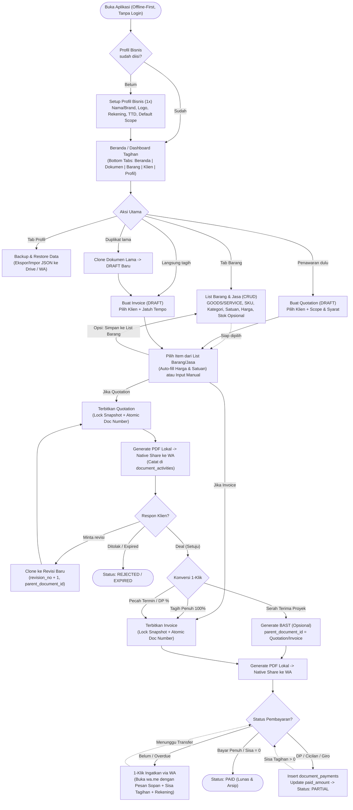
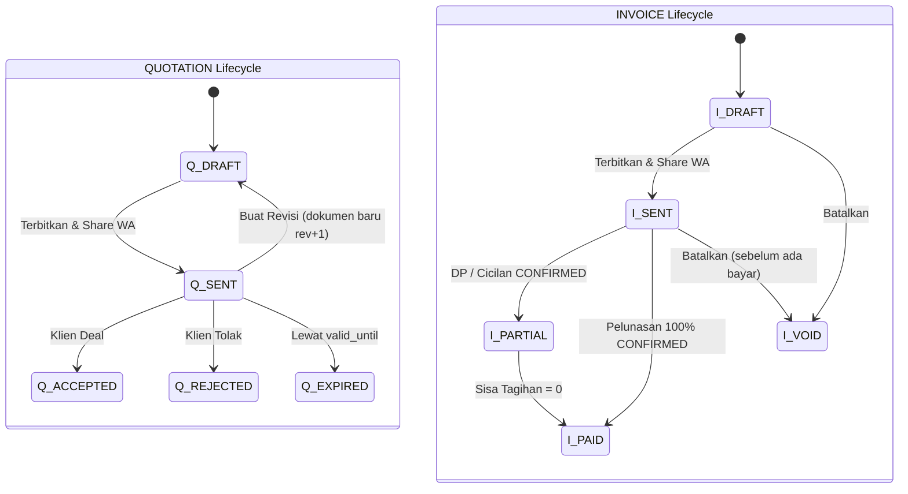
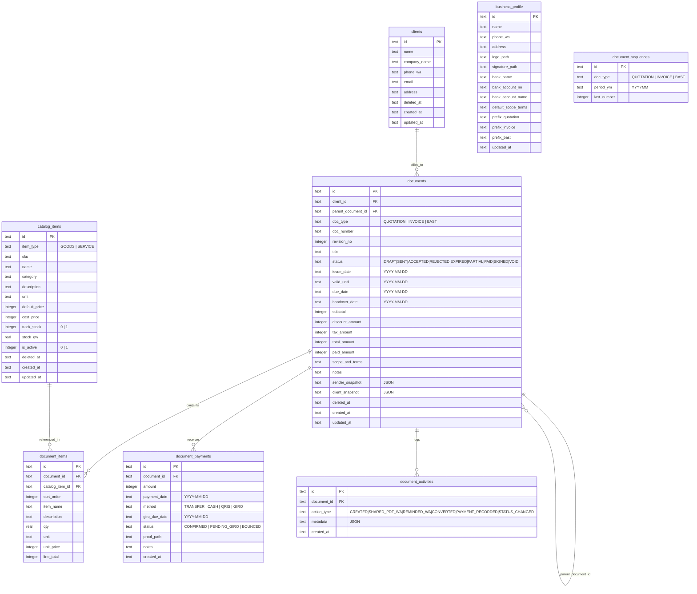

# System Design — Quotation → Invoice Cepat (Ionic + Capacitor Offline-First)

Dokumen desain ulang sistem dari sudut pandang **System Analyst**, **Software Architect**, dan **Software Engineer** untuk aplikasi lintas platform (**Android, iOS, & Web PWA**) berbasis **Ionic + Capacitor** dengan penyimpanan **SQLite lokal di HP (*offline-first*, biaya server Rp0)**.

---

## 1. System Analyst — Lingkup, Aktor, & Aturan Bisnis (*Invariants*)

### 1.1 Aktor Sistem (Model Offline-First)
| Aktor | Akses | Peran Utama |
| :--- | :--- | :--- |
| **App User** *(Freelancer / Kontraktor / Pemilik UMKM / Admin)* | **Langsung Pakai (Tanpa Login di v1)** | Kelola profil bisnis, daftar klien, **list barang & jasa**, buat/revisi/konversi *Quotation/Invoice/BAST*, kirim PDF ke WA, catat DP/lunas, dan *backup/restore* data. |
| **Client (Penerima)** | **Tanpa Aplikasi** | Menerima langsung **lampiran file PDF** dan pesan pengingat tagihan di chat WhatsApp mereka. |

### 1.2 Aturan Bisnis Kritis (*Non-Negotiable Invariants*)
1. **Immutability via Snapshot**: Saat dokumen diterbitkan (`SENT` / `PAID`), data pengirim (`business_profile`) dan klien dibekukan ke kolom `sender_snapshot` dan `client_snapshot` (JSON). Perubahan rekening, alamat klien, atau harga di **List Barang (`catalog_items`)** di kemudian hari **tidak boleh** mengubah isi dokumen historis (`document_items` menyimpan salinan nama, satuan, dan harga saat transaksi).
2. **Input Item Fleksibel**: Saat membuat *Quotation/Invoice*, user bisa memilih dari **List Barang & Jasa** (auto-fill nama, satuan, harga standar, dan tetap bisa diedit per transaksi) **atau** mengetik item manual dengan opsi centang *"Simpan ke List Barang"*.
3. **Penomoran Dokumen Atomik**: Nomor urut (`QUO-202611-001`, `INV-202611-001`, `BAST-202611-001`) diambil dari tabel `document_sequences` dalam transaksi SQLite (`BEGIN TRANSACTION`) agar konsisten dan tidak pernah duplikat.
4. **Presisi Nominal Rupiah**: Semua nilai uang disimpan sebagai `INTEGER` (Rupiah bulat, tanpa desimal `REAL`/`FLOAT`) agar bebas dari galat pembulatan. `paid_amount` selalu disinkronkan dari jumlah `document_payments` berstatus `CONFIRMED`.
5. **Overdue sebagai *Derived State***: Status **Jatuh Tempo (*Overdue*)** dihitung dinamis saat query (`doc_type = 'INVOICE' AND status IN ('SENT', 'PARTIAL') AND due_date < date('now', 'localtime')`).
6. **Keamanan Data Lokal (*Backup & Restore*)**: Karena penyimpanan berada di perangkat, MVP **wajib** memiliki fitur ekspor 1 file *backup* `.json` (bisa disimpan ke Google Drive pribadi atau dikirim ke chat WA sendiri) dan *restore* saat ganti HP.
7. **Siap *Cloud Sync* di Versi 2**: Seluruh tabel tetap memakai **UUID (`TEXT`)** sebagai Primary Key serta menyimpan `updated_at` dan `deleted_at` (ISO-8601 UTC) agar kelak mudah ditambahkan sinkronisasi *multi-device* tanpa merombak skema.

---

## 2. Redesigned User Flow & State Machine

### 2.1 End-to-End System Flow (Offline-First Mobile App)



### 2.2 Document Lifecycle State Machine



---

## 3. Software Architecture — Ionic + Capacitor (Android, iOS, & Web)

### 3.1 Tech Stack & Plugin Inti
* **UI & Framework**: **Ionic Framework (React + TypeScript)** + Tailwind CSS — komponen adaptif otomatis untuk Android (Material) dan iOS (Cupertino).
* **Native Runtime**: **Capacitor** — satu *codebase* menghasilkan **Android (`.apk`/`.aab`)**, **iOS (`.ipa`)**, dan **Web PWA**.
* **Local Database**: **`@capacitor-community/sqlite`** (SQLite native di Android & iOS, dengan *fallback* `jeep-sqlite` di Web browser).
* **Local Files & Media**: **`@capacitor/filesystem`** — menyimpan logo usaha, tanda tangan PNG, bukti transfer/giro, file PDF sementara, dan file *backup* `.json`.
* **PDF Generator & WhatsApp Share**:
  * Template HTML/CSS dirender menjadi file PDF lokal di perangkat (`pdf-lib` / `jspdf` / `html2pdf.js`).
  * File PDF disimpan ke `Directory.Cache` lalu langsung dikirim ke WhatsApp menggunakan **`@capacitor/share`** (*Android Share Intent* & *iOS Share Sheet*).
  * Pengingat jatuh tempo membuka chat klien langsung lewat `https://wa.me/628xxx?text=...` berisi pesan sopan otomatis.
* **Notifikasi Lokal *(Opsional v1.1)***: **`@capacitor/local-notifications`** untuk memberi pengingat di HP user saat H-2 sebelum *invoice* jatuh tempo (tetap 100% tanpa server).

### 3.2 Struktur Folder Modular
```text
src/
├── db/
│   ├── client.ts          # Inisialisasi SQLite Capacitor + migrasi versi skema
│   ├── migrations/        # Skrip SQLite DDL (v1_init.sql, dst.)
│   └── backup.ts          # Ekspor & impor penuh database ke JSON
├── modules/
│   ├── profile/           # Repository & hook untuk business_profile
│   ├── clients/           # CRUD klien + pencarian cepat
│   ├── catalog/           # CRUD List Barang & Jasa (SKU, kategori, harga, stok)
│   ├── documents/         # Quotation, Invoice, BAST, atomic numbering, snapshot, conversion
│   ├── payments/          # Catat DP/cicilan/giro & sinkron status lunas
│   └── share/             # HTML-to-PDF renderer, Capacitor Share, WA message builder
├── templates/
│   ├── quotationPdf.ts    # Layout PDF Quotation + blok Scope & Syarat
│   ├── invoicePdf.ts      # Layout PDF Invoice + info rekening & status DP/Lunas
│   └── bastPdf.ts         # Layout PDF Berita Acara Serah Terima (BAST)
└── pages/
    ├── DashboardPage.tsx  # Ringkasan tagihan jatuh tempo & aksi cepat
    ├── DocumentsPage.tsx  # Daftar Quotation, Invoice, BAST + filter status
    ├── DocumentForm.tsx   # Form buat/edit/revisi + picker List Barang & Jasa
    ├── CatalogPage.tsx    # Kelola List Barang & Jasa
    ├── ClientsPage.tsx    # Kelola daftar klien
    └── ProfilePage.tsx    # Profil bisnis, rekening, template scope, Backup/Restore
```

---

## 4. Software Engineer — Redesigned SQLite Database (8 Tabel Ramping)

### 4.1 Entity Relationship Diagram (Local SQLite — Sync Ready)



### 4.2 SQLite DDL (Siap Dipakai di `@capacitor-community/sqlite`)

```sql
PRAGMA foreign_keys = ON;

-- 1. Profil Bisnis (Singleton 1 baris di perangkat)
CREATE TABLE IF NOT EXISTS business_profile (
  id TEXT PRIMARY KEY,
  name TEXT NOT NULL,
  phone_wa TEXT,
  address TEXT,
  logo_path TEXT,
  signature_path TEXT,
  bank_name TEXT,
  bank_account_no TEXT,
  bank_account_name TEXT,
  default_scope_terms TEXT,
  prefix_quotation TEXT NOT NULL DEFAULT 'QUO',
  prefix_invoice TEXT NOT NULL DEFAULT 'INV',
  prefix_bast TEXT NOT NULL DEFAULT 'BAST',
  created_at TEXT NOT NULL,
  updated_at TEXT NOT NULL
);

-- 2. Master Klien
CREATE TABLE IF NOT EXISTS clients (
  id TEXT PRIMARY KEY,
  name TEXT NOT NULL,
  company_name TEXT,
  phone_wa TEXT,
  email TEXT,
  address TEXT,
  deleted_at TEXT,
  created_at TEXT NOT NULL,
  updated_at TEXT NOT NULL
);

-- 3. Master List Barang & Jasa
CREATE TABLE IF NOT EXISTS catalog_items (
  id TEXT PRIMARY KEY,
  item_type TEXT NOT NULL DEFAULT 'GOODS' CHECK (item_type IN ('GOODS', 'SERVICE')),
  sku TEXT,
  name TEXT NOT NULL,
  category TEXT,
  description TEXT,
  unit TEXT NOT NULL DEFAULT 'pcs',
  default_price INTEGER NOT NULL DEFAULT 0 CHECK (default_price >= 0),
  cost_price INTEGER CHECK (cost_price IS NULL OR cost_price >= 0),
  track_stock INTEGER NOT NULL DEFAULT 0 CHECK (track_stock IN (0, 1)),
  stock_qty REAL,
  is_active INTEGER NOT NULL DEFAULT 1 CHECK (is_active IN (0, 1)),
  deleted_at TEXT,
  created_at TEXT NOT NULL,
  updated_at TEXT NOT NULL
);

-- 4. Penomoran Dokumen Atomik
CREATE TABLE IF NOT EXISTS document_sequences (
  id TEXT PRIMARY KEY,
  doc_type TEXT NOT NULL CHECK (doc_type IN ('QUOTATION', 'INVOICE', 'BAST')),
  period_ym TEXT NOT NULL, -- format: YYYYMM
  last_number INTEGER NOT NULL DEFAULT 0,
  UNIQUE (doc_type, period_ym)
);

-- 5. Transaksi Utama (Quotation, Invoice, BAST)
CREATE TABLE IF NOT EXISTS documents (
  id TEXT PRIMARY KEY,
  client_id TEXT REFERENCES clients(id) ON DELETE SET NULL,
  parent_document_id TEXT REFERENCES documents(id) ON DELETE SET NULL,
  doc_type TEXT NOT NULL CHECK (doc_type IN ('QUOTATION', 'INVOICE', 'BAST')),
  doc_number TEXT NOT NULL,
  revision_no INTEGER NOT NULL DEFAULT 0,
  title TEXT,
  status TEXT NOT NULL DEFAULT 'DRAFT' CHECK (
    status IN ('DRAFT','SENT','ACCEPTED','REJECTED','EXPIRED','PARTIAL','PAID','SIGNED','VOID')
  ),
  issue_date TEXT NOT NULL,
  valid_until TEXT,
  due_date TEXT,
  handover_date TEXT,
  subtotal INTEGER NOT NULL DEFAULT 0 CHECK (subtotal >= 0),
  discount_amount INTEGER NOT NULL DEFAULT 0 CHECK (discount_amount >= 0),
  tax_amount INTEGER NOT NULL DEFAULT 0 CHECK (tax_amount >= 0),
  total_amount INTEGER NOT NULL DEFAULT 0 CHECK (total_amount >= 0),
  paid_amount INTEGER NOT NULL DEFAULT 0 CHECK (paid_amount >= 0),
  scope_and_terms TEXT,
  notes TEXT,
  sender_snapshot TEXT, -- JSON string
  client_snapshot TEXT, -- JSON string
  deleted_at TEXT,
  created_at TEXT NOT NULL,
  updated_at TEXT NOT NULL,
  UNIQUE (doc_number, revision_no)
);

-- 6. Rincian Item per Dokumen
CREATE TABLE IF NOT EXISTS document_items (
  id TEXT PRIMARY KEY,
  document_id TEXT NOT NULL REFERENCES documents(id) ON DELETE CASCADE,
  catalog_item_id TEXT REFERENCES catalog_items(id) ON DELETE SET NULL,
  sort_order INTEGER NOT NULL DEFAULT 0,
  item_name TEXT NOT NULL,
  description TEXT,
  qty REAL NOT NULL DEFAULT 1 CHECK (qty > 0),
  unit TEXT NOT NULL DEFAULT 'pcs',
  unit_price INTEGER NOT NULL DEFAULT 0 CHECK (unit_price >= 0),
  line_total INTEGER NOT NULL DEFAULT 0 CHECK (line_total >= 0)
);

-- 7. Riwayat Pembayaran (DP, Cicilan, Giro, Lunas)
CREATE TABLE IF NOT EXISTS document_payments (
  id TEXT PRIMARY KEY,
  document_id TEXT NOT NULL REFERENCES documents(id) ON DELETE CASCADE,
  amount INTEGER NOT NULL CHECK (amount > 0),
  payment_date TEXT NOT NULL,
  method TEXT NOT NULL DEFAULT 'TRANSFER' CHECK (method IN ('TRANSFER', 'CASH', 'QRIS', 'GIRO')),
  giro_due_date TEXT,
  status TEXT NOT NULL DEFAULT 'CONFIRMED' CHECK (status IN ('CONFIRMED', 'PENDING_GIRO', 'BOUNCED')),
  proof_path TEXT,
  notes TEXT,
  created_at TEXT NOT NULL
);

-- 8. Log Aktivitas & Pengingat WA
CREATE TABLE IF NOT EXISTS document_activities (
  id TEXT PRIMARY KEY,
  document_id TEXT NOT NULL REFERENCES documents(id) ON DELETE CASCADE,
  action_type TEXT NOT NULL CHECK (
    action_type IN ('CREATED','SHARED_PDF_WA','REMINDED_WA','CONVERTED','PAYMENT_RECORDED','STATUS_CHANGED')
  ),
  metadata TEXT, -- JSON string
  created_at TEXT NOT NULL
);

-- Performance Indexes
CREATE INDEX IF NOT EXISTS idx_clients_active ON clients(name) WHERE deleted_at IS NULL;
CREATE INDEX IF NOT EXISTS idx_catalog_active ON catalog_items(is_active, name) WHERE deleted_at IS NULL;
CREATE UNIQUE INDEX IF NOT EXISTS uq_catalog_sku ON catalog_items(sku) WHERE sku IS NOT NULL AND deleted_at IS NULL;
CREATE INDEX IF NOT EXISTS idx_documents_type_status ON documents(doc_type, status) WHERE deleted_at IS NULL;
CREATE INDEX IF NOT EXISTS idx_documents_overdue ON documents(due_date)
  WHERE doc_type = 'INVOICE' AND status IN ('SENT', 'PARTIAL') AND deleted_at IS NULL;
CREATE INDEX IF NOT EXISTS idx_documents_parent ON documents(parent_document_id) WHERE parent_document_id IS NOT NULL;
CREATE INDEX IF NOT EXISTS idx_document_items_doc ON document_items(document_id, sort_order);
CREATE INDEX IF NOT EXISTS idx_document_payments_doc ON document_payments(document_id, payment_date);
CREATE INDEX IF NOT EXISTS idx_document_activities_doc ON document_activities(document_id, created_at DESC);
```

### 4.3 Kontrak Local Service Layer (TypeScript)
Karena seluruh data berada di perangkat, *frontend* Ionic memanggil *local service* berikut secara langsung (tanpa HTTP/REST):

| Service Method | Tanggung Jawab |
| :--- | :--- |
| `profileService.getOrSave(payload)` | Baca/simpan profil bisnis, logo, TTD, rekening, & *default scope*. |
| `catalogService.list(query)` / `upsert(item)` | Cari barang/jasa berdasarkan nama/SKU/kategori & simpan master item. |
| `clientService.list(query)` / `upsert(client)` | Cari & tambah cepat data klien. |
| `documentService.saveDraft(doc, items)` | Simpan *draft* Quotation/Invoice sekaligus opsi simpan item baru ke katalog. |
| `documentService.publish(docId)` | Jalankan transaksi atomik: ambil nomor urut, kunci `sender_snapshot` & `client_snapshot`, ubah status ke `SENT`. |
| `documentService.reviseQuotation(docId)` | Duplikat *Quotation* ke `revision_no + 1` dengan `parent_document_id`. |
| `documentService.convert(docId, target, opts)` | 1-klik konversi *Quotation* → *Invoice* (Penuh 100% / DP %) atau *BAST*. |
| `paymentService.record(docId, payment)` | Simpan pembayaran DP/cicilan/giro & sinkron otomatis `paid_amount` + status (`PARTIAL`/`PAID`). |
| `shareService.sharePdfToWA(docId)` | Render PDF lokal → simpan ke cache → panggil `@capacitor/share` + catat `SHARED_PDF_WA`. |
| `shareService.openReminderWA(docId)` | Susun pesan pengingat sopan + sisa tagihan + rekening → buka `wa.me` + catat `REMINDED_WA`. |
| `backupService.exportJson()` / `importJson(file)` | Ekspor/impor seluruh tabel SQLite untuk *backup* aman ke Google Drive atau WA. |
